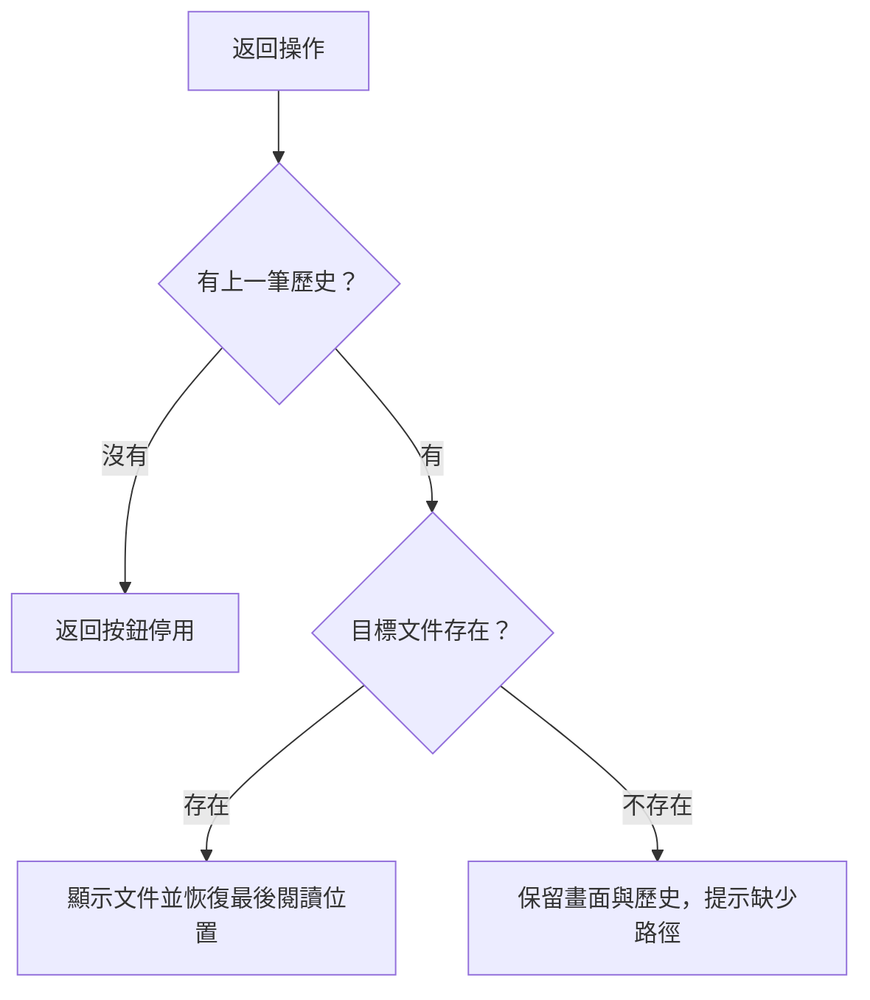

# 返回操作會改變什麼？

合成示例。以下條款是本示例的完整來源，不代表任何真實項目的需求。圖與文字都對應 `reader:N1@1`。

## Navigation contract

每個分頁維護自己的歷史。切換文件及點擊文件連結中的 anchor 會新增歷史；捲動與點擊 Outline 不會新增歷史。重新啟動應用程式會清除歷史。

有上一筆歷史時，返回會嘗試開啟該筆的目標文件。若文件存在，恢復離開它時的最後閱讀位置。若文件不存在，保留目前畫面及該歷史項目，顯示缺少的路徑。沒有上一筆時，返回按鈕停用。

| 使用者操作或條件 | 可以觀察的結果 |
| --- | --- |
| 點擊多個 Outline 標題，再切換文件 | 返回一次就回到前一份文件，不逐一退回 Outline 操作 |
| 返回目標存在 | 顯示目標文件，恢復最後閱讀位置 |
| 返回目標不存在 | 畫面不變，歷史不移除，顯示缺少的路徑 |
| 沒有上一筆歷史 | 返回按鈕停用 |
| 開啟另一分頁或重啟程式 | 歷史分頁隔離；重啟不恢復歷史 |

## Back transition

這張圖只解釋返回操作，不表示所有導覽操作。來源：[導覽契約](#navigation-contract)，`reader:N1@1`。上表提供不依賴圖像的完整對照。

## Verification example

**S1** (`change`; source `reader:N1@1`)：從首頁切到指南，點擊兩個 Outline 標題，再切到筆記。返回一次顯示指南並恢復最後閱讀位置，不能退到較早的 Outline 點擊。這些步驟共同驗證一個情境，不為了版面拆成新的需求 ID。

**S2** (`change`; source `reader:N1@1`)：返回目標已被移除時，畫面及歷史保持不變，介面顯示缺少的路徑。

以上是預期行為與測試設計，並非已執行的測試結果。Mermaid 的呈現仍須在目標閱讀器檢查。
